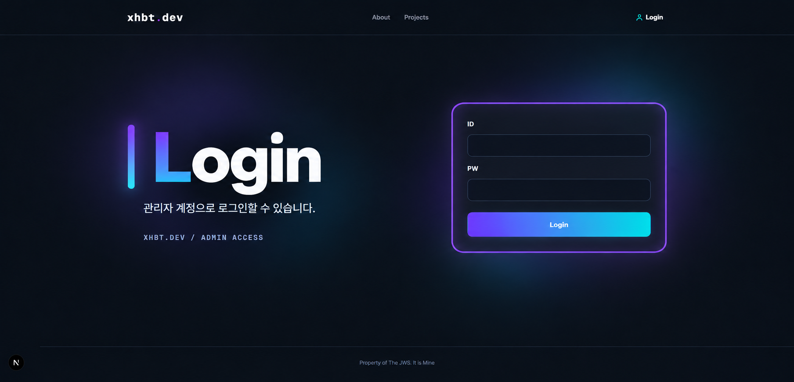

# xhbt.dev

### Developer Portfolio · Full-stack Web Experience

A dark neon portfolio experience for showcasing projects, ideas, and the process behind building them.

[Visit Website](https://xhbt.dev)

## About

xhbt.dev는 개발 프로젝트와 작업물을 소개하기 위한 개인 개발자 포트폴리오입니다.

어두운 네이비 배경에 보라색과 시안색 네온 포인트를 사용해 차분하면서도 기술적인 분위기를 표현했습니다.

## Design Direction

- Dark navy visual system
- Violet and cyan neon accents
- Editorial typography
- Spacious two-column layouts
- Minimal cards with soft glow
- Responsive desktop and mobile experience

## Highlights

### Home

개발자 소개, 기술 스택, 프로젝트, Contact 영역을 하나의 흐름으로 연결했습니다.

### Projects

프로젝트별 대표 이미지와 설명을 카드 형태로 보여주며, 각 프로젝트의 상세 페이지로 이동할 수 있습니다.

### Notice

중요한 공지사항을 고정하고 필요한 경우 팝업으로 안내할 수 있습니다.

### Login

포트폴리오의 다크 네온 분위기를 유지한 별도의 로그인 화면을 구성했습니다.

## Tech Stack

`Next.js` `React` `TypeScript` `Spring Boot`  
`Java` `PostgreSQL` `Supabase` `Vercel` `Render`

## Live

[https://xhbt.dev](https://xhbt.dev)

---

Built with curiosity, code, and continuous improvement.

